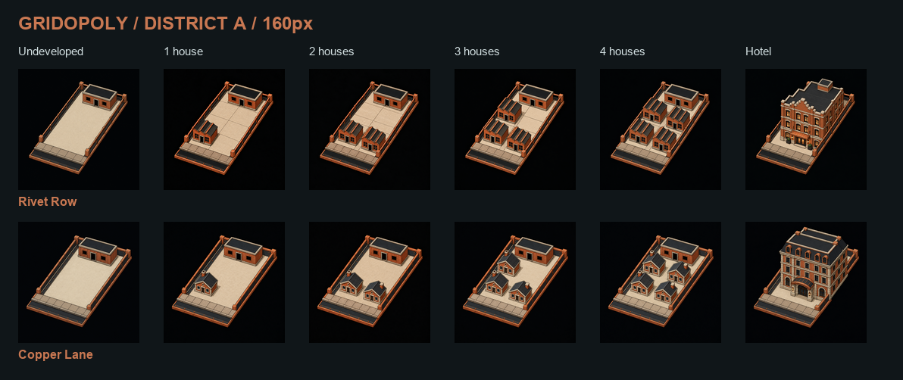

# Gridopoly 地产开发素材 V1

本素材库为全部22块可建造地产提供六级图像：空地、1栋、2栋、3栋、4栋房屋，以及1座旅馆。生成过程保留每块 StreetV3 地块的独特围栏、路缘、街区色与等距视角。

**2026-10-16已完成：110张新增图＋22张原始空地，共132个状态。** 已检查八个街区的逐级画面、160px/128px可读性及全部660个素材文件；[检查记录](review/validation.json)与[机器清单](manifests/development-v1.json)一并保存。运行时仍使用现有素材，新图尚未部署到设备。

[打开互动图鉴](review/index.html) · [设计方案](../../../Docs/game/property-development-art-v1.md) · [原始地块目录](../StreetV3/manifests/grid-city-street-assets-v3.json)

其他街区：[滨水](review/district-b.png) · [艺术](review/district-c.png) · [市政](review/district-d.png) · [脉动](review/district-e.png) · [太阳](review/district-f.png) · [绿荫](review/district-g.png) · [子午](review/district-h.png)

## 六级含义

| buildingLevel | 建筑状态 | 图像规则 |
| --- | --- | --- |
| 0 | 未开发 | 直接保留原地块，后部基础服务建筑不算玩家房屋 |
| 1 | 1栋房屋 | 靠近前方路缘的左侧位置 |
| 2 | 2栋房屋 | 前排左、右两栋 |
| 3 | 3栋房屋 | 前排两栋，加后排左侧一栋 |
| 4 | 4栋房屋 | 两排各两栋，保留可见间隔 |
| 5 | 1座旅馆 | 四栋房屋被一座更高、更完整的旅馆替代；基础建筑融入旅馆 |

游戏中的第五级字段有时叫 landmark；本批美术按用户要求统一表现为旅馆。车站、公用事业、卡片格、税费和角落不加入房屋状态。

## 文件与接入约定

- source/：生成工具输出的原始PNG，以及原始空地的逐字节副本；不裁切、不重画。具体尺寸写在清单内。
- device/：160×160 PNG，适合格子屏的图片区域。
- player/：128×128 PNG，适合现有玩家屏远程图片缓存。
- rgb565-tile/：160×160 RGB565，小端，单张51,200字节。
- rgb565-player/：128×128 RGB565，小端，单张32,768字节。
- manifests/development-v1.json：稳定 tile_id、素材key、buildingLevel、像素尺寸、长度与SHA-256。
- review/：本地互动预览及八组逐级对照图；文件名带-128的是玩家屏尺寸，其余为160px格子屏尺寸。
- generation-plan.json / generation-records.json：建筑设计、生成提示词和修订记录。98条保留原提示词，11条由设计模板重建并标注，首张试作的提示词未留存；110张最终生成原图均完整保留。

文件命名：a2-copper-lane-l0.png 到 a2-copper-lane-l5.png。按 tile_id 与 buildingLevel 查找，不能按16格棋盘上的临时位置硬编码。

预览页可直接在浏览器打开；选择等级后会同时更新全部地产，也可按街区筛选、查看160px实际大小。点击图片打开原图。

## 重新导出

原始大图使用Git LFS保存，克隆后先运行 `git lfs pull`。从仓库根目录执行：

~~~powershell
python -m pip install -r Assets/GridCity/DevelopmentV1/tools/requirements.txt
python Assets/GridCity/DevelopmentV1/tools/package_assets.py
python Assets/GridCity/DevelopmentV1/tools/validate_assets.py
~~~

工具只做复制、缩小、格式编码与对照图排版。缺任何新增等级时，默认拒绝标记完整；制作期间可使用 --allow-partial 查看中间结果。

预览页检查工具 `tools/check_preview.py` 另外依赖Playwright和Edge；可传入 `--output` 指定截图目录、`--channel` 指定已安装浏览器。本地检查无需连接树莓派或棋盘。

## 与现有运行版本的关系

StreetV3原始文件保持不变。本批是独立素材库；现有固件仍按地产ID选择空地图并另画等级标记。后续接入需要让格子屏、玩家屏缓存及网页都使用「地产＋等级」选择图片，并在售房、旅馆降级和断线恢复时更新。不能仅复制文件后就宣称设备已经显示新图。

完整132状态的160px RGB565合计6,758,400字节，新增110状态为5,632,000字节，尚未包含程序和其他素材；嵌入固件前必须核对真实应用分区。玩家屏应继续按需加载，不能同时缓存全部状态。
