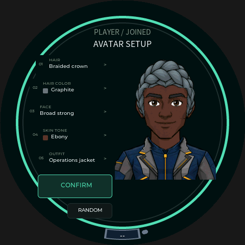
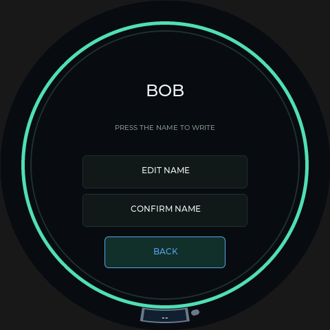

# 2026-10-18 Avatar V2 统一结构与肤色

本轮响应用户提出的发型/脸型错配、F07/F10 脖子过宽、服装朝向不一及 Ebony 白边。素材与兼容代码已提交51b6141d；用户随后要求烧录，四台玩家屏已写验99f6a840，Pi已部署00c978af及最终V2组件，下一新局默认V2。原V1房间保留；用户确认RANDOM出现、姓名页按钮闪动消失，实体新V2头像仍待下一局观察。详见[四屏及服务器部署](player-avatar-v2-rollout-2026-10-18.md)。下方构建阶段的未部署记录保留其时间范围，已取消的COM7旋钮排查没有恢复。

## 素材与设计

- 10 张面部重新绘制，注册后共享同一头部透明轮廓、头顶高度、眼线和面宽。各预设通过五官、眉毛及面部细节保留区别，F07 不再单独放大。
- 一张独立共用脖子放在面部、衣服下面。F07/F10 不再携带各自的脖子；所有衣服正面、肩线水平、领口居中。
- 肤色使用显式材质遮罩。原 V1 在运行时按亮度、饱和度猜测皮肤，可能漏掉偏白的边缘和高光；V2 对皮肤及脖子统一染色，保留眼白、瞳孔和墨线。透明度不随肤色改变。
- H06 Short Coils、H08 Braided Crown、H10 Long Straight 根据用户追加反馈重做。前两款需收紧太阳穴附近的开口；长直发原本主要是压入脸颊过多，不能一起简单缩小。加入不含耳朵的太阳穴/脸颊定位点及内沿检查。

第一轮头顶外包络和结构检查通过，仍不足以证明发型贴脸自然；这项局限和用户反馈已保留。面部含耳朵的外接框不能作为头发内开口宽度。修改前 H06/H08 在部分行与头部主体相隔约 6px，H10 则在部分行压入脸部约 9–12px。修正后的检查同时识别间隙与过量重叠。

源图、提示词、配置、遮罩、组件及组合审查页集中在 [Avatar V2](../../Assets/GridCity/Avatars/V2/README.md)。包含 24 张选用的新源图及一张保留的 H08 早期候选；另外 7 个发型沿用 V1 素材。编译器只进行可复现的注册、材质编码和合成，绘图使用内置 image_gen。

## 两端兼容

V2 为 31 个组件，合成顺序是共用脖子→面部→服装→头发。GAVC schema/encoding 为 2，每个像素 RGBA 加 skinMask；V1 三层及旧染色规则保留。组件 URL、预览缓存和最终头像路径区分版本，已有确认头像不自动迁移。

服务器默认 `GRIDOPOLY_AVATAR_CATALOG_VERSION=1`；显式选择 2 时必须有完整组件包。玩家端支持两版，未设置配方继承房间版本，已确认座位按自身配方版本取最终图。切换组件库时保留正在显示和合成的数据，拒绝迟到的旧版本结果。

代码验证详见 [服务器交付](server-avatar-v2-progress-2026-10-18.md) 和 [玩家端交付的 2026-10-18 节](player-four-screen-setup-progress-2026-09-25.md)。服务器 8 组 native 回归、组件发布工具及普通服务器候选构建通过；玩家端两种默认版本各 1,276 项缓存/解码/合成检查、各 22 项身份链路检查，以及 137 项 setup 与 22,768 项双缓冲检查通过。主机验证不替代完整 ESP32 固件构建或实际屏幕表现。

第一轮真实素材的两组配方经 Python、服务器 C++ 和玩家端合成器逐字节对照一致。该证据绑定第一轮组件，不能用于声称后续发型改图已验证；最终素材与追加比对记录另列。

## 最终素材数字检查

修正后共31个GAVC，**1,353,679 bytes**，与两个132,000字节预览合计1,617,679 bytes，低于2,304KiB已接收缓存预算；不将HTTP临时缓冲计入此数。相对第一轮仅h6/h8/h10三个文件改变，其余28项SHA不变。

- 14项素材测试、全包格式/CRC/容量验证通过。
- 1,000种结构组合、100组头顶覆盖、100组脸/衣服接缝检查通过；无内部颈部孔洞。外轮廓附近的背景候选像素仍保留在诊断图中。
- H06/H08/H10各搭配10张面部，共30组专项内沿检查通过：H06检查41行、H08检查54行、H10检查69行，内沿轻微覆盖头部主体，透明裂缝和过量重叠失败均为0。
- 288次染色覆盖不变检查通过。数字目视审查覆盖100发脸、100脸衣、80肤色脸型格，以及3发型×3脸型×2肤色的18组前后对照；不声称逐一看过160,000个完整颜色组合。
- 浏览器直接解码GAVC并做整数合成，5组原始320图/220×300裁切与Python的SHA完全一致，没有JavaScript错误。小头像和编辑缩放仍是浏览器模拟，不冒充LVGL截图。

[acceptance.json](../../Assets/GridCity/Avatars/V2/acceptance.json)记录Codex数字图像复核范围，并绑定源图、注册、遮罩及31组件哈希。用户审美反馈和实屏验收独立于此记录；新改图会使旧批准失效。浏览器比对及发型变更清单位于V2/review。

用户随后在新版自由搭配页的核对请求中明确回复 **“三款现在贴合正常”**。该确认关闭H06/H08/H10本轮网页观感问题，保存在acceptance.json；不扩大为玩家屏已刷机或实体显示验收。

最终同包两组配方已完成三方复核：玩家实际缓存/解码/合成路径172项检查通过，31组件SHA全部吻合；H08/C01/F07/S08/O02 Ebony与H01/C01/F10/S01/O07 Porcelain各132,000字节的色键RGB565与服务器均零差异。服务器原始RGBA及铺底RGB565另与Python零差异。该结果绑定最终1,353,679字节包，完整证据见两端交付报告。

## RANDOM 与姓名页追加需求

用户要求在Avatar Setup的CONFIRM下方加入小型RANDOM按钮。候选支持触摸和旋钮，随机发型、发色、脸型、肤色、服装并更新本地预览；保留配方版本、姓名、席位，不自动确认，保存过程中不允许随机。详细布局和交互见[头像创建规格](../player-console/player-avatar-setup-spec.md)。

用户随后报告姓名编辑页选中按钮周期性闪没再出现、Avatar Setup的CONFIRM没有此现象。真实LVGL修复前回归复现了NameReview的软件路径：三个按钮焦点分别接受普通revision、其它席位身份更新、全局素材失效，每组12次更新均触发12次整页重建、12次失效绘制、12次选中按钮透明度重置。NameHandwriting原本已保留画布，同组后台更新未复现此重复重建。

修复扩展姓名页的控件保留路径：同一房间/席位仅更新变化的姓名、焦点、连接提示和toast；页面、房间或席位真正变化时仍重建。没有修改触摸驱动、手写识别或电池逻辑。修复后每组上述计数均为0，74项实际LVGL检查通过；包括姓名变更/空名样式、旋钮焦点、触摸进入手写、断线恢复提示与toast过期。RANDOM的状态回归共163项通过，覆盖两种目录、ID范围、无自动确认、保存期禁用和本地草稿保持。

以下为480×480实际LVGL主机渲染截图，使用最终V2真实组件输出作头像，不是网页仿制或实物照片。静态截图用于布局检查，连续更新计数来自上述回归，仍需部署后确认实体屏幕观感。

| Avatar Setup | Name Review |
| --- | --- |
|  |  |

## 启用边界

普通ESP32构建曾两次遇到工具链内部错误：匿名`TransportIdentityPayload{}`聚合赋值分别在身份快照和清理路径触发Xtensa GCC ICE。相关三处统一改成具名默认初始化后赋值，保留原成员默认值；两次失败日志和对应输入均保留在玩家端证据目录，不将失败构建当作可刷固件。最终构建结果见玩家端交付续记。

最终普通Wi-Fi玩家固件已于2026-10-18 05:44:57 UTC完整编译通过：12MHz、原viewe-md80et-v10电池配置、无SelfTest/显示诊断，默认catalog仍为1并支持房间显式选择V2。应用SHA-256为`99f6a8405ca9da1f2ad7169da60fa7b32d02a36269f8d1be9ab377b927fc7788`，program使用1,952,614 bytes、静态RAM使用127,400 bytes；HWCDC链接检查通过。冻结输入清单SHA为`6e719cc8337cf6b38f6e1957c56ef615de2aac9e40f09ebd5686b9c591cff0f4`，构建发生于本轮提交之前，candidate的gitRevision记录的是基准c09f0e25，具体修改以冻结源码清单为准。

以上为素材、可交互预览、兼容代码和普通固件的构建交付记录。随后用户授权的四屏烧录及Pi配套切换已完成，现场结果见[部署报告](player-avatar-v2-rollout-2026-10-18.md)。真实新V2房间中的组合与编辑性能仍待现场验证。数字图像审查、用户网页审美确认和实屏验收分别记录，不能把结构检查通过称为所有组合完美。
