# From my workbench / 实物照片集

[← English README](../../README.md) · [← 中文README](../../README.zh-CN.md) · [PCB files / PCB设计](../hardware/README.md) · [Print files / 打印模型](../../Mechanical/README.md)

From an empty circuit board to something I can pick up and play with. These are the real parts behind Gridopoly, including the awkward in-between stages.

从一块还没焊元件的PCB，到能拿在手里的棋盘。这些照片记录的是Gridopoly实际做出来的样子，也包括装配到一半的过程。

**All 11 photos added on October 18, 2026 are below.** Click a photo for a larger, unannotated JPEG. The photos show several prototype stages; use the hardware and model guides for current assembly files. Original HEIC files remain untouched; these web copies have been resized, converted to sRGB, and stripped of camera metadata.

**本次11张照片都在下面。** 点击可以查看较大的无标注JPEG。照片包含不同阶段的原型，复刻时请以硬件和模型文档为准。HEIC原文件没有改动；仓库提供缩放、转换为sRGB并移除拍摄元数据的网页版本。

## The whole board / 先看整盘

<table>
  <tr>
    <td align="center" valign="top">
      <a href="../../.github/assets/photos/2026-10-18/gridopoly-workbench.jpg">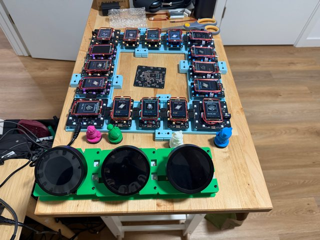</a> 
      <strong>The board on my workbench 工作台上的整套原型</strong> 
      The powered 16-tile board, four pieces and three player consoles in this photo. 照片里是已点亮的16格棋盘、4枚棋子和3台玩家控制器。 IMG_1957.HEIC
    </td>
    <td align="center" valign="top">
      <a href="../../.github/assets/photos/2026-10-18/assembled-board-frame.jpg">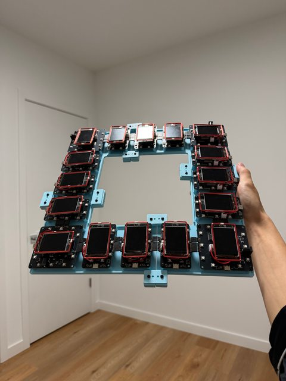</a> 
      <strong>Sixteen modules, one frame 16块模块，拼成一整盘</strong> 
      The assembled board held upright, with the displays off. 竖起来看的整盘结构；拍摄时屏幕未点亮。 IMG_1949.HEIC
    </td>
  </tr>
</table>

## A controller of your own / 每个人的控制器

<table>
  <tr>
    <td align="center" valign="top">
      <a href="../../.github/assets/photos/2026-10-18/player-console-side.jpg">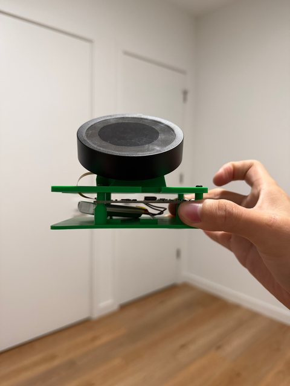</a> 
      <strong>A controller, from the side 玩家控制器的侧面</strong> 
      The round screen, power board and battery share one printed stand. 圆屏、供电板和电池装进同一套打印支架。 IMG_1947.HEIC
    </td>
    <td align="center" valign="top">
      <a href="../../.github/assets/photos/2026-10-18/player-power-board.jpg">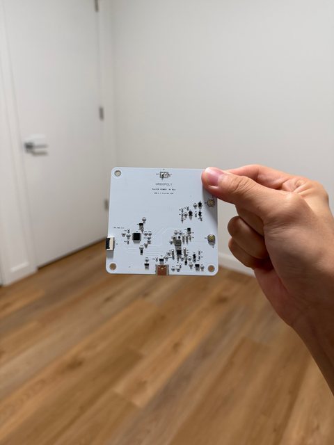</a> 
      <strong>The player power board 玩家供电板</strong> 
      The photographed prototype is marked PLAYER POWER R1 RC4. 照片中的原型板标有PLAYER POWER R1 RC4。 IMG_1951.HEIC
    </td>
    <td align="center" valign="top">
      <a href="../../.github/assets/photos/2026-10-18/player-power-board-reverse-view.jpg">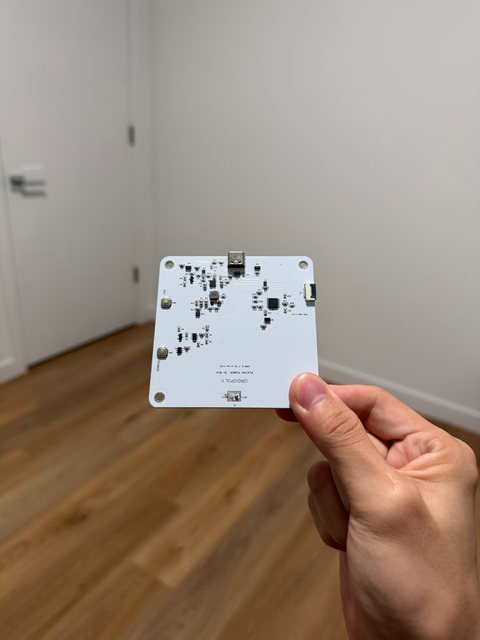</a> 
      <strong>Another look at the power board 换个角度看供电板</strong> 
      A close look at the player power PCB and its connectors. 玩家供电PCB和接口的近照。 IMG_1950.HEIC
    </td>
  </tr>
</table>

## What goes into a tile / 拆开看一个格子

<table>
  <tr>
    <td align="center" valign="top">
      <a href="../../.github/assets/photos/2026-10-18/tile-corner-assembly.jpg">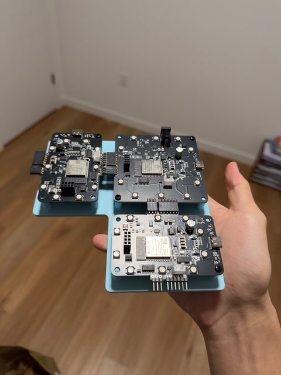</a> 
      <strong>How a corner joins the board 角落与长边怎样相连</strong> 
      One corner PCB and two long tile PCBs on a printed base. 一块角落PCB与两块长边PCB，固定在打印底座上。 IMG_1948.HEIC
    </td>
    <td align="center" valign="top">
      <a href="../../.github/assets/photos/2026-10-18/long-tile-pcb.jpg">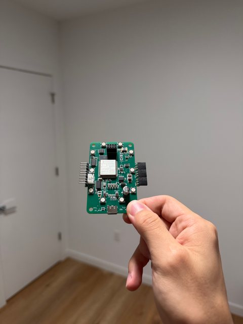</a> 
      <strong>Before fitting the display 安装屏幕之前</strong> 
      The populated long tile PCB, with its ESP32 module and perimeter LEDs. 焊好元件的长边PCB，可以看到ESP32模组和周围的LED。 IMG_1952.HEIC
    </td>
    <td align="center" valign="top">
      <a href="../../.github/assets/photos/2026-10-18/long-tile-with-display.jpg">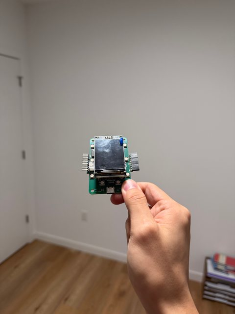</a> 
      <strong>With the display fitted 装上屏幕之后</strong> 
      The same style of long tile module with the LCD in place. 长边模块装上LCD后的样子。 IMG_1953.HEIC
    </td>
  </tr>
  <tr>
    <td align="center" valign="top">
      <a href="../../.github/assets/photos/2026-10-18/tile-display-side.jpg">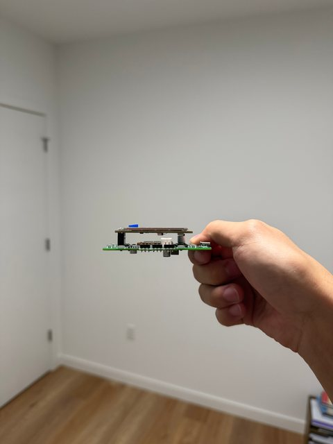</a> 
      <strong>A little space underneath 屏幕下面留出的空间</strong> 
      A side view of the LCD, PCB and mounting standoffs. 从侧面看LCD、PCB和安装支柱之间的距离。 IMG_1954.HEIC
    </td>
    <td align="center" valign="top">
      <a href="../../.github/assets/photos/2026-10-18/rfid-coil.jpg">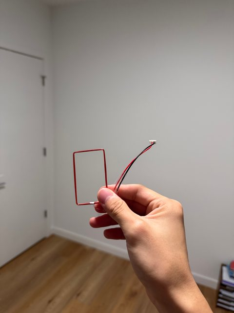</a> 
      <strong>The coil around each tile 每个格子的读卡线圈</strong> 
      The rectangular RFID antenna before mounting around a display. 围到屏幕周围之前的矩形RFID天线。 IMG_1955.HEIC
    </td>
    <td align="center" valign="top">
      <a href="../../.github/assets/photos/2026-10-18/unpopulated-tile-pcb.jpg">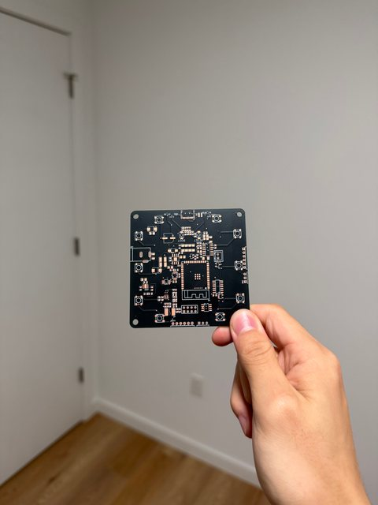</a> 
      <strong>Before the components go on 还没有焊上元件的时候</strong> 
      An unpopulated tile PCB: the traces and component pads are visible. 尚未贴装的格子PCB，能看到走线和元件焊盘。 IMG_1956.HEIC
    </td>
  </tr>
</table>

## A few labels help / 加上引导线看结构

These are edited, annotated guides based on the real photos. The unannotated views above and below remain available for comparison. / 下面是基于实拍照片制作的标注版；上方和下方保留无标注版本，方便对照。

<table><tr>
<td width="33%" align="center"><a href="../../.github/assets/photos/2026-10-18/annotated/player-console-annotated.jpg">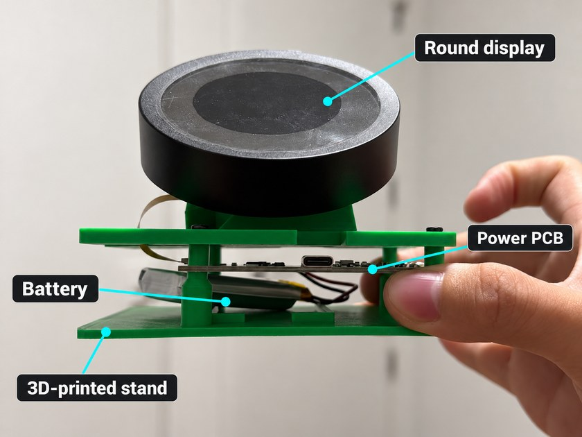</a> <strong>Player console / 玩家控制器</strong></td>
<td width="33%" align="center"><a href="../../.github/assets/photos/2026-10-18/annotated/tile-corner-annotated.jpg">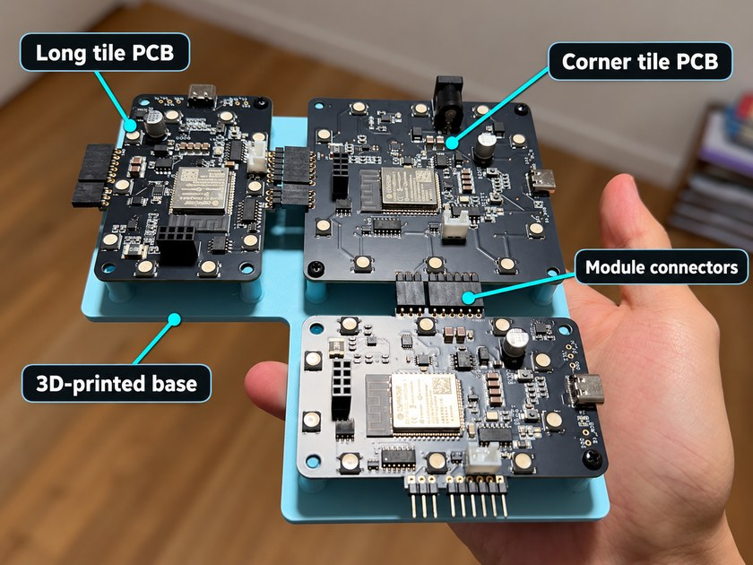</a> <strong>Tile connections / 格子连接</strong></td>
<td width="33%" align="center"><a href="../../.github/assets/photos/2026-10-18/annotated/rfid-piece-annotated.jpg">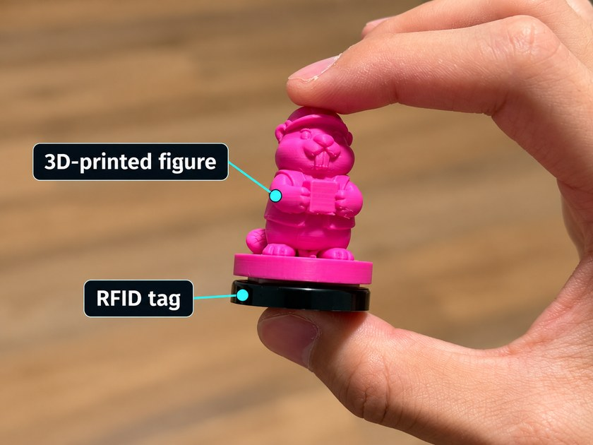</a> <strong>Figure + tag / 角色与标签</strong></td>
</tr></table>

<strong>Earlier build photos / 之前的开发照片（4张）</strong>

<table>
<tr>
<td width="50%" align="center"><a href="../../.github/assets/photos/gridopoly-16-tile-board.jpg">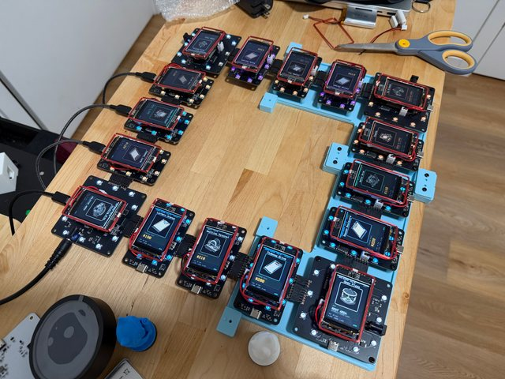</a> An earlier workbench view / 早期整盘工作台照片</td>
<td width="50%" align="center"><a href="../../.github/assets/photos/gridopoly-pcbs-and-base.jpg">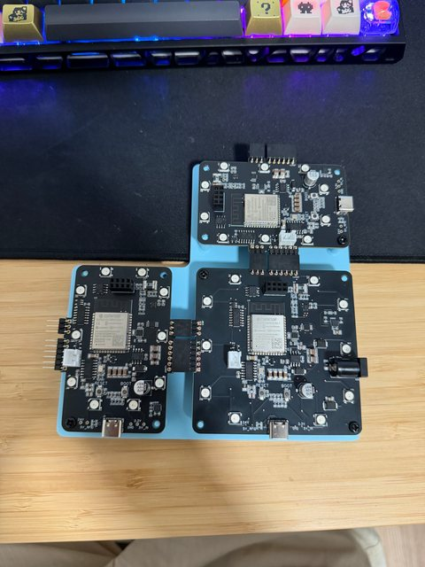</a> Tile PCBs and a corner base / 格子PCB与角落底座</td>
</tr>
<tr>
<td width="50%" align="center"><a href="../../.github/assets/photos/gridopoly-player-console-and-power.jpg">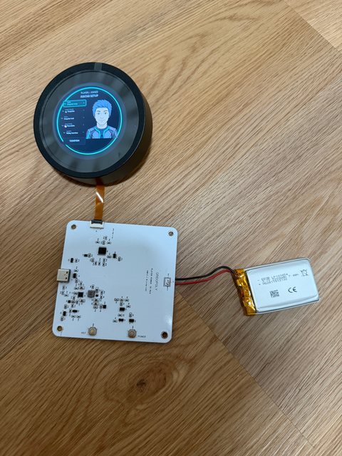</a> Player screen, PCB and battery / 玩家屏、供电板和电池</td>
<td width="50%" align="center"><a href="../../.github/assets/photos/gridopoly-rfid-piece.jpg">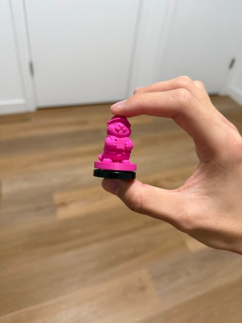</a> Printed figure and RFID tag / 打印角色与RFID Tag</td>
</tr>
</table>

[Photo sources and editing notes / 照片来源与标注说明](../../.github/assets/photos/README.md) · [Back to the documentation / 返回文档中心](../README.md)
