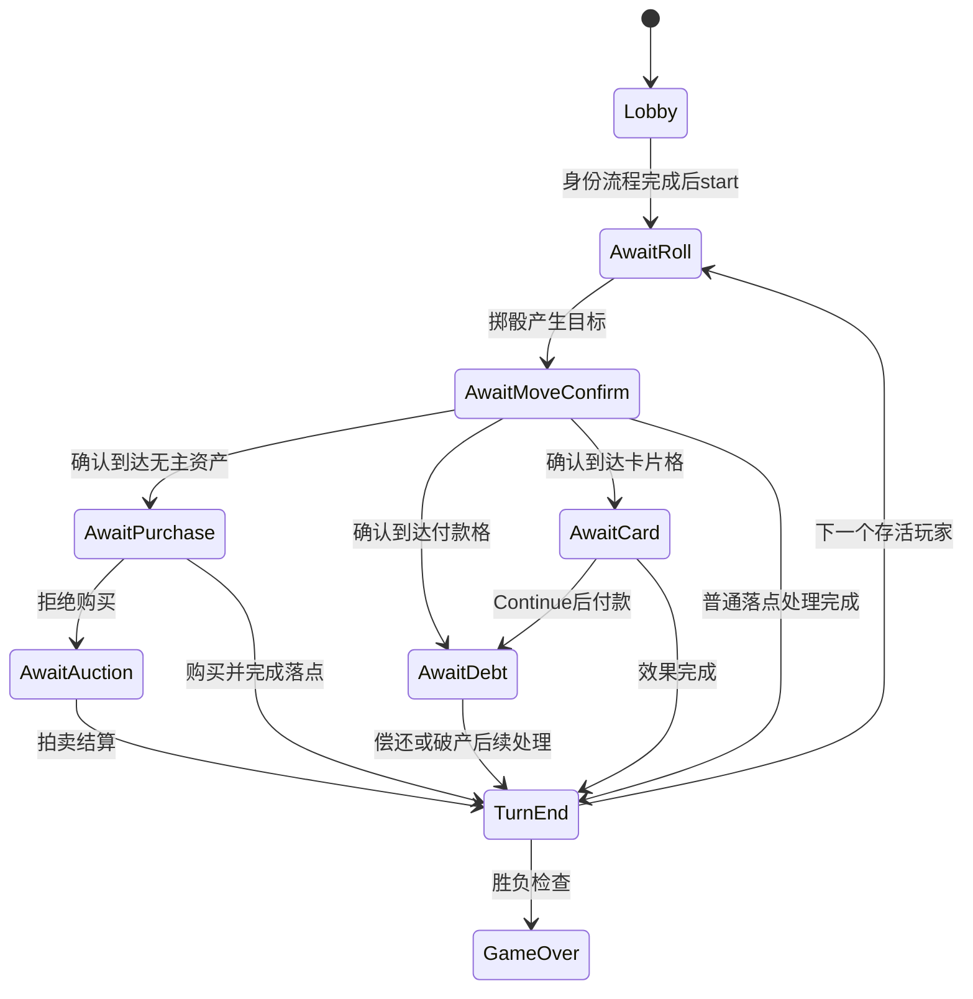

# Gridopoly 当前权威状态机

更新：2026-10-15。枚举以[GameModel.h](../../Firmware/libraries/GridopolyCore/src/gridopoly/core/GameModel.h)为准，转移以[GameEngine.cpp](../../Firmware/libraries/GridopolyCore/src/gridopoly/core/GameEngine.cpp)为准。身份、游戏、配对及传输会话是不同状态域，不用一个页面名代替多个权威状态。

## 开局身份和Tag

自动建局冻结设备席位，Identity保持准备阶段；逐人TagPairing席位阶段7完成后，该玩家可独立进入外貌/姓名，下一人继续配对。全部必需玩家绑定并ready才进入五秒倒计时，然后开启Core游戏。未获席位显示等待新局，不显示假金额主页。

配对状态为Disabled、WaitingReader、ClearRequired、AwaitingTag、SuccessRemove、AlreadyBound、MultipleTags、ReaderOffline、TimedOut、Cancelled、Complete。room/session/revision及新扫描共同隔离旧事件；成功取回提示可跨下一人的reader继续存在。详见[现行跨端契约](../firmware/ring-onboarding-contract-2026-09-26.md)。

## 物理拓扑与开局的关系

16/24/32/40 地图均可在单块未分配 reader 或开放链上执行 Tag 配对。ORDER 完整环只决定地图模块映射：全部 15 秒租约内在线模块必须属于同一个环，长度匹配地图且四角/long 角色正确。最后一条有效边、地图切换和重连触发重算；失效撤销派生，不改变 Core 游戏阶段。未分配 reader 可以配对，但不能作为确定目标格触发自动到达。

发现列表也独立于本局席位：四屏在线可能仍对应三真人加一机器人，第四屏 `seatId=0` 等待新局。只有显式新局才重新冻结 1～4 真人并补足四席。

## Core实际阶段

| 数值 | GamePhase | 当前含义 |
| ---: | --- | --- |
| 0 | Lobby | Core尚未正式开始，服务端身份流程可以仍在准备 |
| 1 | AwaitRoll | 当前玩家掷骰或处理限制区选择；允许规则限定的资产管理 |
| 2 | AwaitMoveConfirm | 有pendingMove，等待权威位置确认；自动到达另受首帧gate约束 |
| 3 | AwaitPurchase | 无主资产明确购买/拒绝 |
| 4 | AwaitAuction | 介绍就绪屏障后轮转竞价/放弃 |
| 5 | AwaitDebt | 强制付款、筹款、偿还或合法破产 |
| 6 | TurnEnd | 已完成当前落点，可结束回合及管理资产 |
| 7 | GameOver | 胜者确定，拒绝继续对局操作 |
| 8 | AwaitCard | 等待卡片Continue或对应效果/债务推进 |

该图仅概括主要路径，不是全部转移：双骰可由落点完成直接返回AwaitRoll，限制区第三次失败付款后继续移动，卡片移动还可触发新落点；破产可直接切换下一存活者或进入GameOver。具体continuation不得按图省略。

## 到达和财务边界

玩家动画只呈现结果；`ConfirmPosition`需匹配当前player/target。RFID自动到达由服务端调用同一权威事务，配对库存不能用于到达。Action17在MoveGuide真实首帧后报告，不推进位置或重复结算。

真人付款进入AwaitDebt，并由合法PayDebt动作完成。没有独立RentClaim枚举、20秒地主确认或Core持有的10秒扣款定时器。圆屏ForcedPayment本地倒计时可提交PayNow/PayDebt，不能保证屏幕离线后的服务器定时扣款；旧设计图与此不同。建筑库存/整组清算、破产 continuation与赢家均由Core决定。

## 恢复和验证

游戏、Identity、冻结席位、Tag绑定及未取回限制持久化；配对恢复生成新session fence。ORDER 物理邻接/租约及人工锚点仅在进程内存，重启不沿用旧边或锚点；换 room/board 清人工意图，但仍新鲜的物理证据可重投影到匹配地图。UDP重连恢复同席位，不能把断线真人变为bot。

重复、过期room/session/revision、旧请求及乱序投影必须拒绝或幂等；页面恢复不能重新播一次已完成到达/卡片或重复扣款。主机和隔离集成已有回归；最近部署已核对正常停服离线→原席位自动重连，版本与真人 connected 位可随恢复变化，其他业务不应改变。真实 pendingMove 断网、完整实体环/四屏配对与整局仍待现场验收，见[部署证据](../firmware/server-all-online-ring-progress-2026-10-15.md)。

[当前规则](game-rules.md) · [旧设计状态图](../archive/game-state-machine-design-before-2026-09-27.md) · [当前交接](../CURRENT-DEVELOPMENT-HANDOFF.md)
