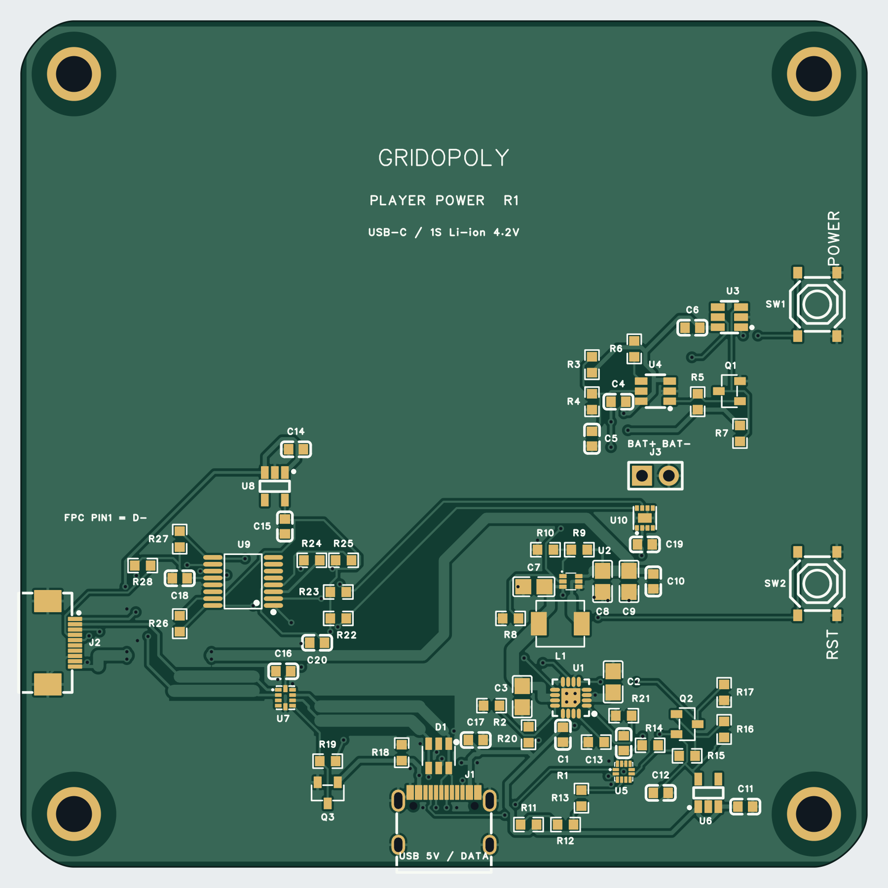

# 玩家屏幕电池底板 R1：布局布线及制造候选

2026-09-27。**PCB 布局、全部网络布线、铺铜和制造文件已完成；当前为 RC1 制造候选，尚未完成制造放行与实板验收。** 不把 PCB DRC 通过等同于屏幕、电池和固件已实测成功。

## 已完成

- 采用用户最新分配的 **80×80 mm、圆角 R5** 板框。板框、四个孔、J1 USB-C、J2 FPC、SW1 POWER、SW2 RST 的原始位置和旋转全部保留。原先 40–50 mm 的设想不再指导本版本。
- 两层铜、标称 1.6 mm、1 oz；68 个器件均放在顶面。J3 是电池裸焊线孔，实际贴装 67 件、29 种料号。
- 532 段走线、79 个过孔、上下两层 GND 铺铜；严格原生 PCB DRC 返回 **0 项**。68 件/243 脚与原理图、PCB 导出网表、实际焊盘逐项一致。
- 原理图与 PCB 的 SW1/SW2 位号统一；POWER/RST 作为原位置功能丝印保留。J2 的 1–10 脚保持用户要求的反向映射。
- 再以独立离线检查核对固定几何、连接、两层结构、器件包络无重叠、BOM 与坐标表，**34/34 通过**。

预览由实际 Gerber 重建，表示铜、阻焊、丝印和钻孔；不是装配实物或 3D 机械验证。底层预览也采用从顶面透视的坐标，没有镜像成翻板视图。

## 交付文件

| 文件 | 用途 |
| --- | --- |
| [Gerber ZIP](Manufacturing-RC1/PlayerPower-R1-Gerber.zip) | 标准化的 10 文件制板候选包；已去掉重复的过孔钻孔子文件 |
| [BOM](Manufacturing-RC1/PlayerPower-R1-BOM.csv) | 67 个贴装件，含立创料号；UTF-8 CSV |
| [CPL](Manufacturing-RC1/PlayerPower-R1-CPL.csv) | 同一 67 个件的顶面坐标和原生旋转角；J3 不贴装 |
| [制造说明](manufacturing-notes.md) | 板材、孔、阻焊、钢网、装配方向、文件规范与放行条件 |
| [布局及验证报告](layout-review.md) | 电源与 USB 布局依据、已检查范围和限制 |
| [主任务独立复核](independent-review.md) | 34 项副本复验、18 项独立制造文件核对，以及 DRC/USB 的实际检查范围 |
| [首板验收](bringup-checklist.md) | 充电、开关、欠压、USB、遥测的记录表 |
| PCB1-routed.source.jsonl / PCB1-netlist.json | 当前 PCB 原生源码快照与网表；源码依赖原工程器件库，不是独立导入工程 |
| final-live-audit.json / layout-verification.json | 原生检查回读、34 项离线核对及 SHA-256 |
| fixed-constraints.json / before-layout-* | 用户指定机械位置与布局前备份，不覆盖旧版原理图审查证据 |
| NativeExports/ | 原生未规范化文件，仅供追溯，**不要代替 Manufacturing-RC1 上传** |

原理图、芯片选型及按键接点修复证据继续保存在 [DesignDraft](../DesignDraft-2026-09-27/README.md)，本目录是其 PCB 后续版本；没有修改长边板、角落板或现场屏幕固件。

## 尚未闭合的放行条件

1. **FPC 实物匹配**：J2 候选 C2856798 要求尾端厚度 0.30±0.03 mm。实际排线含补强片厚度、装入方向、端到端通断和供电触点额定电流尚未核实。用户确认的左右顺序和反转要求已执行，不替代插接实测。
2. **电池规格**：确认 1S/4.2 V 充满、带保护板、允许约 500 mA 充电及足够放电电流；当前电路不防电池反接、不检测电芯温度，关机后仍有静态耗电。
3. **原理图警告**：客户端严格 SCH DRC 仍仅返回 41 条 warning 汇总，明细不可由当前可用接口读取；没有把它们默认视为无害。这与当前 PCB DRC 的 0 项是两件事。
4. **制造与首板验收**：板厂核对 USB 叠层/阻抗、QFN 钢网及装配方向；首板实测电源、热、USB 正反插/恢复烧录及 UART 电量状态。SC18IM704 查询时仅 25 颗贴装库存，采购时重新确认并计入损耗。

这些项目未通过前，本包不标记为可直接量产。下单动作未执行，库存未锁定。

## 离线复核

在本目录执行 `node verify-layout.cjs`。不连接设备、不依赖第三方包、不改动 EDA；核对的是已捕获版本，并将结果写入 layout-verification.json。若在线工程发生变更，必须重新导出与复核，不能沿用本次 DRC 结果。

本目录为冻结交付，复验时先复制到临时目录，以免脚本生成的新时间戳覆盖归档证据。`SHA256SUMS.json` 仅覆盖本目录的冻结文件；持续更新的外部文档入口只列于提交清单，不纳入制造包哈希。目录内 `.gitattributes` 保留原始字节，避免 Windows 换行转换使校验失效。
