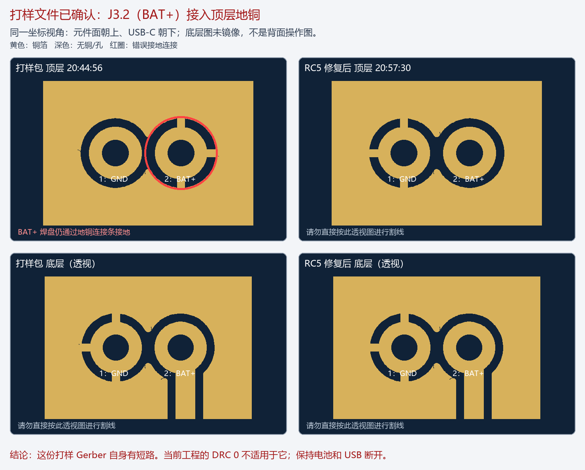

# 打样包复核：确认 J3.2 顶层地铜导致 BAT 短路

复核日期：2026-10-14（America/New_York）。用户提供打样文件 `Gridopoly_PCB1_20260927_204456.zip`，文件内 Gerber 标记生成于 **2026-09-27 20:44:56**。本次直接检查该 ZIP，原文件未改写。

**结论：这份打样 Gerber 自身存在致命铜箔短路，不能直接使用或继续投产。J3.2 已定义为 BAT_PACK/BAT+，但顶层仍保留三条接地铜桥。** 该缺陷足以解释所有板 BAT+/BAT− 约 0.2Ω，同时 SYS_RAW 约 18.92kΩ、5V_SCREEN 几 MΩ 的现象。物理返修尚未执行，是否有次生器件损伤仍未知。

## 确定的位置和证据

以元件面朝上、USB-C 朝下观察，J3 在板子上边居中附近：左脚 J3.1 是 GND，右脚 J3.2 是 BAT+。

| 项目 | 打样包证据 |
| --- | --- |
| J3.1／GND | Gerber 坐标 x=38.99916、y=−5.00126mm |
| J3.2／BAT_PACK | x=41.00068、y=−5.00126mm，即距左边约41mm、距上边约5mm |
| 错误连接 | **顶层、J3.2 向上／向下／向右三条宽0.254mm铜桥连接周围GND铺铜** |
| 孔 | 两脚均为0.80mm镀通孔；地脚通过底层地铜连通，正极错误接入顶层地铜，形成完整 BAT↔GND 通路 |
| 包内网名 | `FlyingProbeTesting.json` 自己标明 `J3_1=GND`、`J3_2=BAT_PACK`，与实际铜几何矛盾 |

原始 `Gerber_TopLayer.GTL` 第4944–4947行在 Copper 段绘制上下铜桥，第5176–5177行绘制右铜桥，使用 `%ADD11C,0.254*%`。这是铜层实际导体，不是丝印或阻焊图。详细摘录见[独立原始文件核验](independent-report.md)。

## 与修复版本的关系

冻结 RC5 原生 Gerber 生成时间为 **2026-09-27 20:57:30**，比此包晚12分34秒。比较的是铜几何，不只看文件名或时间：RC5 已把地铜热连接移回 J3.1，并给 J3.2 正极完整避让。两包顶层显著差异集中在 J3；底层只有微小几何差异，未发现另一个铜层短路。

这与[RC5 历史修复记录](../Layout-2026-09-27-RC5/battery-polarity-review.json)的“翻转J3后旧地铜碰正极、初查6项错误、重铺修复”相符。**用户提供的打样包保留了修复前的错误顶层铜。** 无需假定工厂装配错误就能解释短路，但目前不能确认谁何时提交了哪个订单文件，也不能据此排除实物另有装配或上电损伤。

## 检查覆盖与 DRC 的边界

1. 对包内顶层、底层铜进行布尔几何连通分析；跨层连接来自这份 ZIP 的真实 PTH 钻孔，非当前 CAD 的孔列表。
2. 包内飞针数据去重为243个元件引脚、62个网名。其中31个是自动 `NET_x` 名称，包含10个功能网的别名和21个未接脚代号；不能把62当作62条实际功能网络。与已核对的当前网表映射后为41个功能网。
3. 找到唯一混网组 **BAT_PACK/GND**；本轮没有发现其他几何短路、功能网断路或端点铜缺失。还用当前243脚/82过孔/536线段模型交叉检查，结果一致；独立复核再次从原始铜桥语句确认。
4. 对RC5原生包用同法检查，BAT与GND分离。当前工程DRC 0以及10月5日的检查针对修复后的数字设计，不能替代本打样包复核。
5. ZIP不含原生工程的DRC报告。`FlyingProbeTesting.json`只是数据文件，其存在不证明工厂已按其执行、通过飞针测试；不能推断工厂测试流程。制造包未绑定到已检查版本，是此前验证覆盖的缺口。
6. 此包未提供BOM、CPL或实物装配确认照片，故不判断贴装料号/方向已经正确。静态连通通过的其他网络也不等于充电、USB、电量计、热性能等功能已实测通过。

## 处理与后续

- 这份20:44:56包保留为故障证据，停止用它重新打样。新制造包必须与原理图、PCB、BOM/CPL及铜层检查绑定，不能只查看当前编辑器的DRC0。
- [仅几何返修仿真](virtual-rework-feasibility.md)验证：只移除J3.2顶层三条接地铜桥的小段，可分离BAT/GND，且保留正极到C2/C19/U1/U10、负极到系统地及其余网络连通。**这不是实物返修通过。下方切口投影覆盖底层BAT走线，不能钻穿、深切或照着透视图切背面；切口距焊盘外缘仅约0.077mm。** 铜桥可能被J3塑料座遮挡，需正反面近照确定可达性，可能要先拆插座后由熟练人员处理。
- 当前仍保持电池、USB、屏幕断开。返修后要先验证BAT↔GND不再近零，同时J3.2到C2.1/U1.2、J3.1到系统GND仍连通，然后限流检查电源和功能。找到短路原因不等于器件已经无损或整板正常。
- 本次没有修改现场工程、生成改写的投产Gerber、割线、拆件、上电或烧录；故障状态为“文件原因已定位，实物未修复”。

## 文件及复现

- 输入SHA256：`2344f34c45307a879c9a3274bddd53681152dcf42d9fb47637cb690d554405b6`；[原包副本](Gridopoly_PCB1_20260927_204456.zip)、[逐文件清单](input-manifest.json)。
- [全网检查](order-package-audit.json)、[独立连通结果](independent-connectivity.json)、[铜几何差异](geometry-difference.json)、[局部比较图](order-vs-rc5-j3.png)。
- `audit-order-package.py` 用 gerbonara1.6.3、shapely2.1.2、Pillow，直接读取本目录原包和相邻RC5的NativeExports；Windows Arial/微软雅黑字体仅影响示意图。弧线近似误差1µm，3µm容差仅识别点在铜上，不用于跨间隙连接。它不测试制造/装配质量或实物功能。
- 其余独立核验脚本保留当时绝对输入路径，只作第二种算法证据；共享Git索引交总指挥统一处理。早期[收到ZIP前的调查](../BatShortAudit-2026-10-14/README.md)是历史阶段，本报告取代其“根因未定位”的状态。
