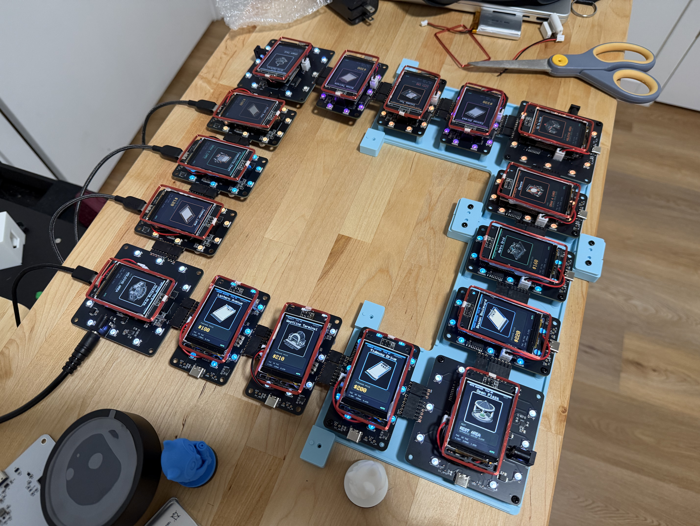
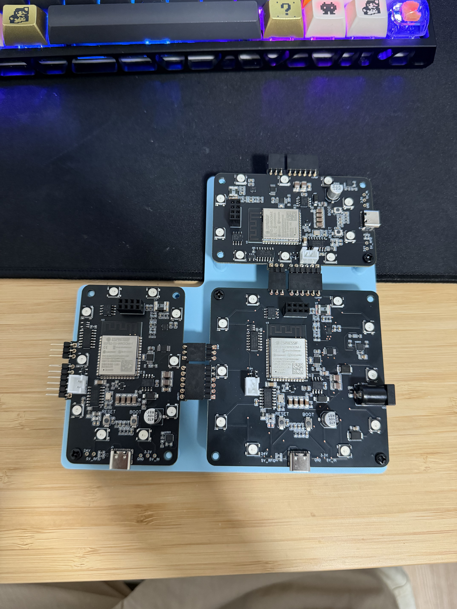
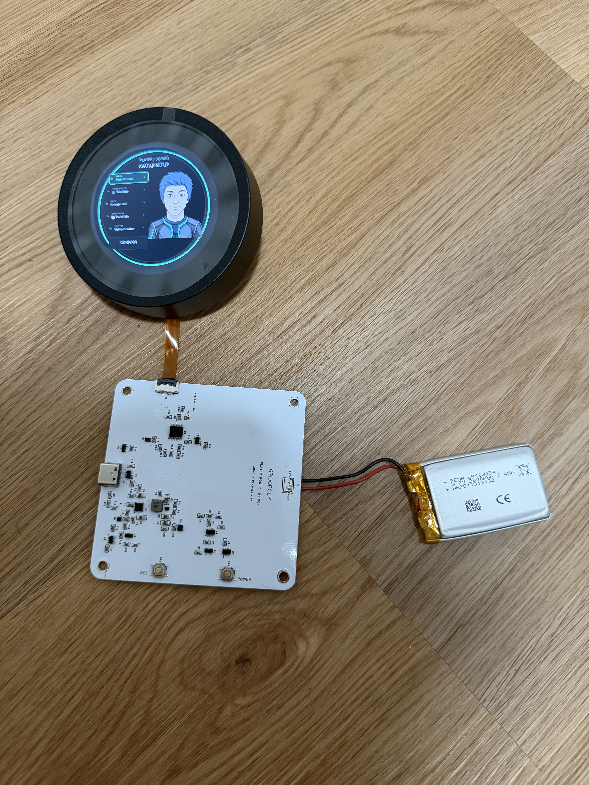
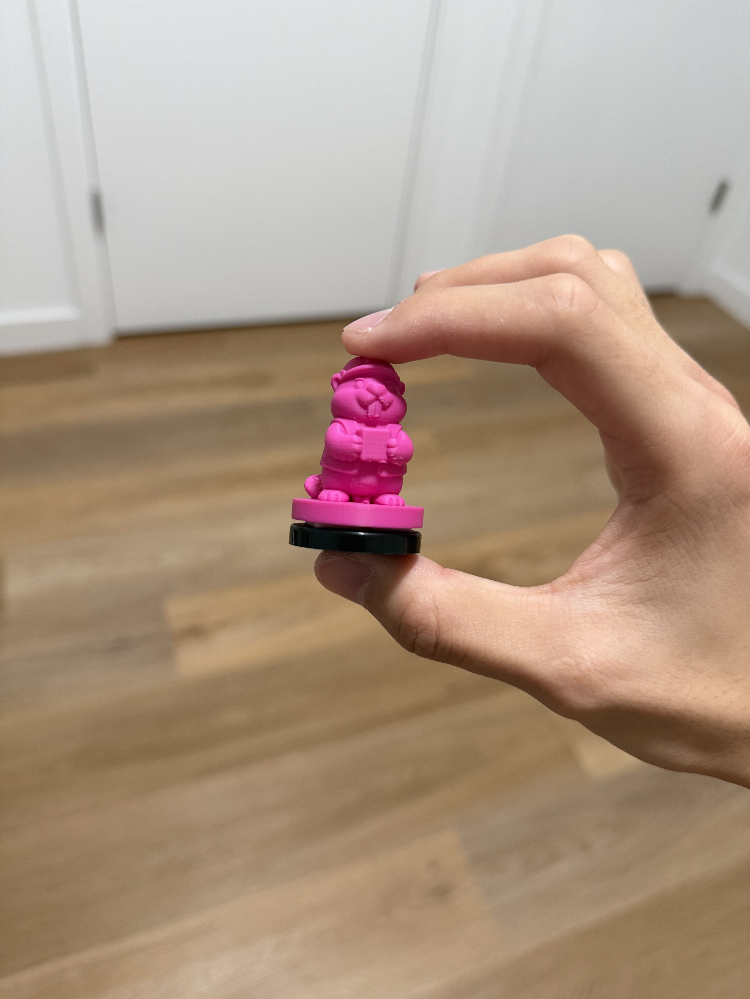
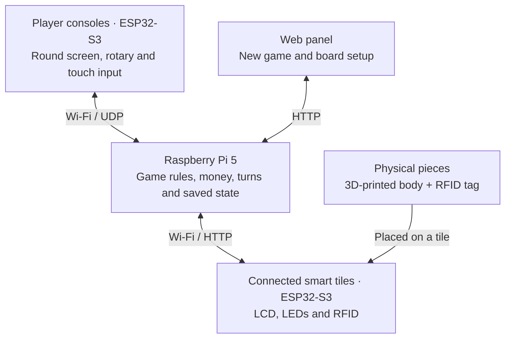

<h1 align="center">Gridopoly</h1>

<p align="center">
  <strong>A real board game, with the bookkeeping built in.</strong><br />
  Move physical pieces. Let the board recognize them, light up the next stop, and keep track of the money.
</p>

<p align="center">
  <a href="README.zh-CN.md">简体中文</a> &middot;
  <a href="#why-this-exists">The story</a> &middot;
  <a href="#on-my-workbench">Photos</a> &middot;
  <a href="#where-it-is-now">Progress</a> &middot;
  <a href="#inside-the-repository">Code &amp; design files</a> &middot;
  <a href="#build-your-own">Build your own</a>
</p>

<p align="center"><strong>16 smart tiles</strong> &nbsp;·&nbsp; <strong>4 player consoles</strong> &nbsp;·&nbsp; ESP32-S3 + Raspberry Pi</p>

<p align="center">
  <a href=".github/assets/photos/gridopoly-16-tile-board.jpg"></a><br />
  <sub>The 16-space prototype on my workbench. Custom boards, printed parts, and a game taking shape.</sub>
</p>

## Why This Exists

In the summer of 2026, I went on a trip with four friends. The five of us spent a lot of our time at the hotel playing Monopoly. I loved having everyone around the same board, but counting bills, making change, and passing money back and forth started to feel like a chore.

I thought about playing the phone version. It could handle all the bookkeeping, but tapping a flat, 2D screen didn't feel nearly as fun as moving a real piece across the table. I wanted the convenience of a digital game while keeping the feeling of an actual board game.

On my first day back home, I started sketching out how I could build it. Each tile could have a screen. The board could recognize our pieces. A computer could handle payments and track movement, while we still sat together and played with something physical.

That idea became **Gridopoly**. It's grown into my own hardware and software project: circuit boards, firmware, a game server, player interfaces, and parts I can print and hold in my hand. This repo is where I'm sharing the work as I build it.

## On My Workbench

<table>
  <tr>
    <td width="33%" align="center" valign="top">
      <a href=".github/assets/photos/gridopoly-pcbs-and-base.jpg"></a><br />
      <strong>The board, underneath</strong><br />
      <sub>Custom tile PCBs join together on a printed base.</sub>
    </td>
    <td width="34%" align="center" valign="top">
      <a href=".github/assets/photos/gridopoly-player-console-and-power.jpg"></a><br />
      <strong>Your own controller</strong><br />
      <sub>A round screen, rotary control, power board, and battery.</sub>
    </td>
    <td width="33%" align="center" valign="top">
      <a href=".github/assets/photos/gridopoly-rfid-piece.jpg"></a><br />
      <strong>A piece the board can recognize</strong><br />
      <sub><strong>Pink, above:</strong> 3D-printed figure<br /><strong>Black, below:</strong> RFID tag<br />Together: one physical game piece.</sub>
    </td>
  </tr>
</table>

<sub>Real build photos from different stages of the project. Click any photo for the full-size view.</sub>

## What Playing Looks Like

1. **Build the board.** Connect the modules into a ring. The ORDER connections tell the server their physical sequence; each module's configured type lets it align the corners.
2. **Make it yours.** Start a game from the web panel, pair a tagged piece with each player, then choose an avatar and name. Bots fill unused seats, up to four players in total.
3. **Take your turn.** Use your own controller to roll, check assets, and make decisions. The destination tile lights up; you move your piece there, and RFID confirms its arrival.
4. **Keep playing around the table.** The server handles money, rent, ownership, auctions, and saved state. You still have a real board and real pieces in front of you.

## Where It Is Now

**October 16, 2026 — the 16-space physical prototype is working.** The small board has reached its main hardware-integration milestone: 12 long tiles and four corners, connected and recognized as one board.

| Milestone | Current result |
| --- | --- |
| Board order and map assignment | A real 16-module ORDER ring has been detected, with automatic tile assignment and the four corners aligned correctly. |
| Physical pieces | All 16 modules have successfully recognized tags with the coils mounted slightly above the displays. |
| Local wireless network | 16 tiles + four player consoles have connected together through the Raspberry Pi's ALFA USB Wi-Fi adapter. The server and hotspot start automatically. |
| Tile screens and lighting | All 16 tiles passed the **V0.36** orientation and lower-brightness check. Eight tiles now run **V0.37**, adding house/hotel artwork downloaded into RAM; the first board passed all five artwork levels, cache reuse, and reboot clearing. |
| Game software | Player discovery, bot seats, tag pairing, avatar/name setup, transactions, and game-state persistence are implemented. |

I'm now working toward a complete four-player hardware playtest, smoother player-screen interactions, the final printed assembly, and expansion to **32 tiles + four controllers**. Those are the next checks; the 16-space milestone doesn't mean every future configuration has already been tested.

[Detailed progress and remaining work →](Docs/CURRENT-DEVELOPMENT-HANDOFF.md) · [V0.36 hardware check →](Docs/firmware/tile-display-rotation-2026-10-16.md)

## Inside the Repository

The project includes the code for both kinds of module and the server, along with PCB designs, printable parts, game assets, and the notes behind them.

| What you want to explore | Files and starting points |
| --- | --- |
| **PCB designs** | [Hardware guide](Docs/hardware/README.md) · [Board revisions](Docs/hardware/pcb-variants.md) · [EasyEDA project](PCB%20Files/Gridopoly-current.epro2) · [Design files](PCB%20Files/) — tile boards, corner boards, and the player power board, with schematics and revision-specific manufacturing files. |
| **3D-print models** | [Model library](Mechanical/README.md) — board bases, player-console stands, and tagged pieces; STL/3MF files, editable Blender projects, current and historical versions, and assembly guides. |
| **Smart-tile firmware** | [TileModule](Firmware/TileModule/README.md) — ESP32-S3 display, LEDs, RFID, ORDER discovery, and server communication. |
| **Player-console firmware** | [PlayerConsole](Firmware/PlayerConsole/README.md) — round-screen UI, rotary/touch input, avatars, handwriting, and player actions. |
| **Server and web panel** | [Raspberry Pi server](Server/RaspberryPi/README.md) — C++ game authority, web controls, device discovery, persistence, and deployment scripts. |
| **Game engine and content** | [Core](Firmware/libraries/GridopolyCore/) · [Protocol](Firmware/libraries/GridopolyProtocol/) · [Assets](Assets/) · [Game data](GameData/) · [Rules](Docs/game/game-rules.md). |
| **Build, flash, and understand it** | [Batch-flashing tools](Tools/release/README.md) · [Firmware guide](Docs/firmware/firmware-development-guide.md) · [Documentation index](Docs/README.md). |

### Pick something to print

- **Board:** [Full16 R1 base](Mechanical/BoardBase/Full16_R1/README.md) — four matching L-shaped quarters and eight joining plates.
- **Controller:** [V2 R3 stand](Mechanical/PlayerConsoleStandV2/revisions/R3_EAR_REINFORCED/README.md) — screen support, PCB mounting, battery cradle, and [illustrated assembly guide](Mechanical/PlayerConsoleStandV2/revisions/R3_EAR_REINFORCED/assembly_guide/Gridopoly_Player_Stand_R3_Assembly_Guide_CN.pdf).
- **Pieces:** [Four 30 mm figures](Mechanical/PlayerTokens/README.md) — fox, beaver, owl, and turtle, to combine with physical RFID tags.

Start with the current-version links in the model library. Older models are kept for the build history, and each design's notes explain its fit checks and what still needs a physical trial.

## How It Fits Together



The tile connectors carry **24 V power and the ORDER signals** used to find the sequence. Game data travels over the local Wi-Fi network. The Raspberry Pi keeps the authoritative state, so every screen and tile follows the same game. RS485 is reserved on the hardware and is not the active game link.

## Build Your Own

For the complete checkout, including the large model files, install [Git LFS](https://git-lfs.com/) before cloning:

```bash
git lfs install
git clone https://github.com/Ha22yX/Gridopoly.git
cd Gridopoly
git lfs pull
```

Start with the [hardware revisions](Docs/hardware/pcb-variants.md) and [model library](Mechanical/README.md), then follow the [tile](Firmware/TileModule/README.md), [controller](Firmware/PlayerConsole/README.md), and [server](Server/RaspberryPi/README.md) build guides. Hardware revisions and their matching files matter; the design notes distinguish tested prototypes from newer candidates.

You can also explore the game software without assembling the board. With a C++ toolchain, CMake, and Ninja installed:

```bash
cmake -S . -B build -G Ninja -DCMAKE_BUILD_TYPE=Release
cmake --build build
ctest --test-dir build --output-on-failure
```

For the Pi, follow the [server deployment guide](Docs/firmware/raspberry-pi-server.md) and [USB hotspot setup](Docs/firmware/usb-ap-deployment-2026-10-15.md). The local game panel is at `http://10.42.0.1/` when connected to the Gridopoly network.

## Still Building

This started with a game in a hotel room. Now I'm learning how to make the electronics, software, and printed parts work together as something my friends and I can actually play. If you try building part of it, spot a mistake, or have an idea, I'd love to hear about it in [Issues](https://github.com/Ha22yX/Gridopoly/issues).

<sub>Code and design files are public. A project-wide license has not been selected yet; third-party components retain their own licenses. Gridopoly is an independent project inspired by playing Monopoly.</sub>
