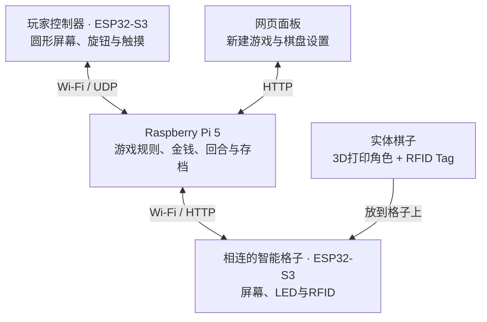

<h1 align="center">Gridopoly</h1>

<p align="center">
  <strong>一套会自己记账的真实桌游。</strong><br />
  亲手移动棋子，让棋盘识别它、点亮目的地，再把算钱的事交给电子系统。
</p>

<p align="center">
  <a href="README.md">English</a> &middot;
  <a href="#为什么会有这个项目">项目故事</a> &middot;
  <a href="#我的工作台">实物照片</a> &middot;
  <a href="#现在做到哪了">当前进度</a> &middot;
  <a href="#仓库里有什么">代码与设计</a> &middot;
  <a href="#想自己做一套">动手复刻</a>
</p>

<p align="center"><strong>16块智能格子</strong> &nbsp;·&nbsp; <strong>4台玩家控制屏</strong> &nbsp;·&nbsp; ESP32-S3 + Raspberry Pi</p>

<p align="center">
  <a href=".github/assets/photos/gridopoly-16-tile-board.jpg"></a><br />
  <sub>工作台上的16格原型。自己设计的电路板、打印出来的零件，还有一点点成形的桌游。</sub>
</p>

## 为什么会有这个项目

2026年暑假，我和四个朋友出去旅行。我们五个人在酒店里经常玩大富翁，围着同一张棋盘一起玩很开心，但数纸币、找零、来回付钱，玩久了真的有点麻烦。

我当时想过，直接玩手机版不就方便了吗？可面对一块平面的2D屏幕，总觉得少了亲手移动棋子、和朋友围坐一桌的感觉。我想把电子系统的方便，放进一套真正能摸到、能拼起来的桌游里。

旅行回家的第一天，我就开始构思和分析方案：每个格子可以有自己的屏幕，棋盘可以识别我们的棋子，电脑负责交易和移动状态，而我们依旧面对面坐在桌子旁边玩。

于是就有了 **Gridopoly**。它后来慢慢变成一个从电路板、固件、服务器，到玩家界面和3D打印零件都要自己想办法的项目。这个仓库记录的，就是我把那个想法一点点做出来的过程。

## 我的工作台

<table>
  <tr>
    <td width="33%" align="center" valign="top">
      <a href=".github/assets/photos/gridopoly-pcbs-and-base.jpg"></a><br />
      <strong>棋盘下面是什么</strong><br />
      <sub>自己设计的格子PCB，连接在打印底座上。</sub>
    </td>
    <td width="34%" align="center" valign="top">
      <a href=".github/assets/photos/gridopoly-player-console-and-power.jpg"></a><br />
      <strong>每个人的控制器</strong><br />
      <sub>圆形屏幕、旋钮、供电板和电池。</sub>
    </td>
    <td width="33%" align="center" valign="top">
      <a href=".github/assets/photos/gridopoly-rfid-piece.jpg"></a><br />
      <strong>棋盘认得出的小棋子</strong><br />
      <sub><strong>上方粉色：</strong>3D打印角色<br /><strong>下方黑色：</strong>RFID Tag<br />组合起来，就是一枚完整棋子。</sub>
    </td>
  </tr>
</table>

<sub>这些是真实开发过程中的照片，拍摄阶段有所不同。点击图片可以查看原图。</sub>

## 玩起来是什么样

1. **先拼好棋盘。** 模块连接成环，服务器通过ORDER连接识别实际排列顺序，也会校对角落位置。
2. **绑定自己的棋子。** 在网页面板开始新游戏，玩家依次配对Tag，再设置外貌和名字。缺少的席位由机器人补齐，总共最多4人。
3. **轮到你行动。** 用自己的控制屏摇骰子、查看资产和作出选择。目标格子亮灯，你把棋子移过去，RFID识别后确认到达。
4. **继续围着桌子玩。** 金钱、租金、地产、拍卖和游戏存档交给服务器处理，桌面上的棋盘与棋子依然是真的。

## 现在做到哪了

**2026年10月16日：16格实物原型已经跑起来了。** 12块长边、4块角落组成的小棋盘，已经完成主要硬件联调里程碑。

| 里程碑 | 当前结果 |
| --- | --- |
| 顺序检测与格子分配 | 已检测真实16模块ORDER闭环，自动按顺序分配格子，四个角落正确对应。 |
| 实体棋子识别 | 线圈略高于屏幕安装后，16个模块都已成功识别Tag。 |
| 本地无线网络 | 树莓派搭配ALFA USB网卡，已有16格＋4台玩家屏同时联网记录；服务器和热点开机自启。 |
| 屏幕与灯效 | 16块均已升级 **V0.36**，每块的屏幕方向、当前图文和降低后的LED亮度都已实际确认。 |
| 游戏程序 | 已实现玩家发现、机器人补位、棋子配对、外貌与姓名、交易结算和游戏状态保存。 |

接下来进行四真人完整实体对局验证，继续打磨玩家屏幕交互和整套打印结构，再扩展到 **32格＋4台控制器**。16格里程碑已经实现，后续配置和异常场景会继续验证。

[详细进展与待办 →](Docs/CURRENT-DEVELOPMENT-HANDOFF.md) · [V0.36逐板验证记录 →](Docs/firmware/tile-display-rotation-2026-10-16.md)

## 仓库里有什么

两类模块的程序和服务器源码都在这里，也包括PCB设计、打印模型、游戏素材，以及开发过程中整理的说明。

| 想看什么 | 文件与入口 |
| --- | --- |
| **PCB设计** | [硬件说明](Docs/hardware/README.md) · [板型与版本](Docs/hardware/pcb-variants.md) · [嘉立创EDA工程](PCB%20Files/Gridopoly-current.epro2) · [设计文件](PCB%20Files/)：长边、角落和玩家供电板，包含原理图及对应版本的制造资料。 |
| **3D打印模型** | [模型库](Mechanical/README.md)：棋盘底板、玩家屏幕底座和棋子，含STL/3MF、可编辑Blender工程、当前版、历史版及装配说明。 |
| **格子模块完整程序** | [TileModule](Firmware/TileModule/README.md)：ESP32-S3屏幕、LED、RFID、ORDER检测和服务器通信。 |
| **玩家屏完整程序** | [PlayerConsole](Firmware/PlayerConsole/README.md)：圆屏UI、旋钮与触摸、外貌、手写姓名和玩家操作。 |
| **服务器与网页面板** | [Raspberry Pi服务器](Server/RaspberryPi/README.md)：C++游戏中控、网页操作、设备发现、状态保存和部署脚本。 |
| **规则、协议与素材** | [游戏核心](Firmware/libraries/GridopolyCore/) · [通信协议](Firmware/libraries/GridopolyProtocol/) · [美术资源](Assets/) · [游戏数据](GameData/) · [规则说明](Docs/game/game-rules.md)。 |
| **构建、烧录与开发说明** | [批量烧录工具](Tools/release/README.md) · [固件开发指南](Docs/firmware/firmware-development-guide.md) · [文档总入口](Docs/README.md)。 |

### 从这些模型开始打印

- **棋盘：**[Full16 R1底板](Mechanical/BoardBase/Full16_R1/README.md)，4个相同L形主件＋8片连接片。
- **玩家控制器：**[V2 R3底座](Mechanical/PlayerConsoleStandV2/revisions/R3_EAR_REINFORCED/README.md)，屏幕支架、PCB固定、电池仓，以及[中文图文装配PDF](Mechanical/PlayerConsoleStandV2/revisions/R3_EAR_REINFORCED/assembly_guide/Gridopoly_Player_Stand_R3_Assembly_Guide_CN.pdf)。
- **棋子：**[4个30mm角色](Mechanical/PlayerTokens/README.md)，狐狸、河狸、猫头鹰和乌龟，搭配实体RFID Tag使用。

优先看模型库标出的当前版本。旧模型也会保留，方便了解修改过程；每个版本的说明里会记录尺寸检查、试装结果和还需要实物验证的部分。

## 它们怎么配合



格子之间的连接传递 **24V供电和ORDER顺序信号**，游戏数据走本地Wi-Fi。树莓派统一保存游戏状态，各个屏幕和格子都跟随同一局游戏。硬件上的RS485目前是预留接口，没有作为游戏通信通道启用。

## 想自己做一套

完整下载项目和大型3D模型文件前，请先安装 [Git LFS](https://git-lfs.com/)：

```bash
git lfs install
git clone https://github.com/Ha22yX/Gridopoly.git
cd Gridopoly
git lfs pull
```

先看[硬件版本](Docs/hardware/pcb-variants.md)与[模型库](Mechanical/README.md)，再按[格子固件](Firmware/TileModule/README.md)、[玩家屏固件](Firmware/PlayerConsole/README.md)和[服务器](Server/RaspberryPi/README.md)的说明构建。制作时要使用同一修订配套的文件，设计说明会标出已测试的原型与较新的候选版本。

暂时没有硬件也可以先研究游戏程序。安装C++工具链、CMake和Ninja后：

```bash
cmake -S . -B build -G Ninja -DCMAKE_BUILD_TYPE=Release
cmake --build build
ctest --test-dir build --output-on-failure
```

树莓派的安装与网络配置见[服务器部署](Docs/firmware/raspberry-pi-server.md)和[USB热点说明](Docs/firmware/usb-ap-deployment-2026-10-15.md)。连上Gridopoly网络后，本地网页面板地址是 `http://10.42.0.1/`。

## 还在继续做

这个项目从酒店里的一局桌游开始，现在我在学习怎么把电路、软件和打印零件组合成一套能和朋友真正玩起来的东西。如果你尝试制作其中一部分、发现了问题，或者有什么想法，欢迎来 [Issues](https://github.com/Ha22yX/Gridopoly/issues) 聊聊。

<sub>代码与设计文件已公开；项目级许可证暂未选定，第三方组件保留各自许可。Gridopoly是受到玩大富翁经历启发的独立项目。</sub>
